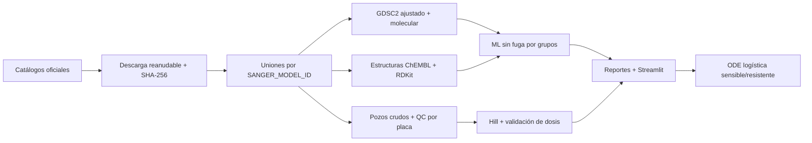

<p align="center">
  
</p>

<h1 align="center">Kexia Cancer Research AI</h1>

<p align="center">
  Modelado reproducible y preclínico de respuesta farmacológica en líneas celulares de cáncer de mama.
</p>

<p align="center">
  
  
  
  
</p>

> [!IMPORTANT]
> Este repositorio es para investigación computacional preclínica. No recomienda tratamientos, no estima probabilidades de curación y no convierte predicciones en evidencia clínica.

## Qué contiene

Kexia integra datos públicos de GDSC2/Cell Model Passports, descriptores químicos verificados con ChEMBL/RDKit, características moleculares, modelos de aprendizaje automático con particiones resistentes a fuga de información y modelos matemáticos de respuesta a dosis y dinámica poblacional.

| Evidencia verificada | Resultado |
|---|---:|
| Líneas celulares de mama GDSC2 | 52 |
| Compuestos | 295 |
| Observaciones célula–compuesto | 13,388 |
| Pozos crudos retenidos | 2,192,303 |
| Pozos normalizados tras QC | 252,415 |
| Estructuras químicas exactas | 210 |
| Andamiajes Murcko | 191 |

Sí hay IA/ML en el proyecto. El modelo principal es un `HistGradientBoostingRegressor` seleccionado frente a Ridge y Random Forest. También se implementó una red neuronal *two-tower* en PyTorch, pero no fue entrenada en la primera corrida verificada y no se presenta como modelo de producción. El candidato molecular combinado se conserva como experimental. Los binarios entrenados no se redistribuyen en esta entrega: los scripts los regeneran localmente después de aceptar los términos de las fuentes.

## Resultados principales

### Predicción de `LN_IC50`

`LN_IC50` es el logaritmo natural del IC50 ajustado en micromolar: `IC50_uM = exp(LN_IC50)`.

| Protocolo independiente | MAE | RMSE | R² | Pearson | Spearman |
|---|---:|---:|---:|---:|---:|
| Pares nuevos, entidades conocidas | 0.9180 | 1.2285 | 0.7773 | 0.8820 | 0.8334 |
| Células no vistas | 1.3561 | 1.7582 | 0.5825 | 0.7743 | 0.6979 |
| Compuestos no vistos | 1.4576 | 2.0117 | 0.4549 | 0.6917 | 0.6141 |
| Células y compuestos no vistos | 1.7670 | 2.3770 | 0.3211 | 0.5736 | 0.4519 |

El deterioro bajo entidades nuevas es parte del resultado, no un detalle oculto. Los intervalos conformales son marginales y su cobertura observada cae por debajo de 95% bajo los cambios de dominio más difíciles.

### Validación matemática de curvas de dosis

| Modelo de endpoint | Puntos retenidos | MAE | RMSE |
|---|---:|---:|---:|
| Hill de 3 parámetros | 631 | 0.08642 | 0.11918 |
| Hill con fondo cero | 631 | 0.08487 | 0.11495 |
| Comparador log-lineal | 631 | 0.08695 | 0.11732 |

Esto valida interpolación de viabilidad *endpoint*, no la ODE poblacional ni una tasa de muerte clínica. Consulta [Matemáticas y métricas](docs/MATHEMATICS.md) para las ecuaciones, supuestos, métricas e incertidumbre.

## Arquitectura



## Reproducción rápida

Requiere Python 3.11 y suficiente espacio en disco; la matriz RNA-seq oficial por sí sola ocupa aproximadamente 1.29 GB.

```bash
git clone https://github.com/TU_USUARIO/TU_REPOSITORIO.git
cd TU_REPOSITORIO
python -m venv .venv
```

En PowerShell:

```powershell
.\.venv\Scripts\Activate.ps1
python -m pip install --upgrade pip
python -m pip install -r requirements.txt
python -m pip install -e .
python scripts/download_datasets.py
python scripts/prepare_breast_cancer.py
python scripts/prepare_phase2_molecular.py
python scripts/prepare_compound_structures.py
python scripts/train_models.py
python scripts/evaluate_models.py
python scripts/validate_mathematical_models.py
python scripts/run_phase2_experiments.py
python scripts/run_phase2_repeated_validation.py
python scripts/run_phase2_scaffold_evaluation.py
python scripts/audit_mathematical_models.py
python scripts/prepare_temporal_validation.py
python scripts/train_phase2_candidate.py
python scripts/run_simulations.py
python -m pytest
streamlit run app/main.py
```

Para una réplica estricta del entorno verificado se incluye `requirements-lock.txt`. Para más detalle y rutas parciales consulta [REPRODUCIBILITY.md](docs/REPRODUCIBILITY.md).

## Datos y créditos

Los datos crudos, tablas procesadas, predicciones fila por fila y binarios entrenados no se redistribuyen aquí. Los scripts descargan las versiones públicas desde sus fuentes oficiales y `data/metadata/download_manifest.json` registra URL, fecha upstream, tamaño y SHA-256. Esta decisión evita duplicar archivos grandes y, sobre todo, respeta los términos originales.

- [Cell Model Passports / GDSC](https://cellmodelpassports.sanger.ac.uk/downloads/gdsc) — respuesta farmacológica, modelos, mutaciones, CNV, crecimiento y compuestos; [política CC BY-NC-ND 4.0](https://depmap.sanger.ac.uk/documentation/data-usage-policy/).
- [Sanger DepMap: drug sensitivity](https://depmap.sanger.ac.uk/documentation/datasets/drug-sensitivity/) — diseño del ensayo y definición de variables.
- [Sanger DepMap: expression](https://depmap.sanger.ac.uk/documentation/datasets/expression/) — RNA-seq procesado y escala `log2(TPM + 1)`.
- [ChEMBL REST API](https://www.ebi.ac.uk/chembl/api/data/docs) — estructuras químicas verificadas; ChEMBL indica licencia CC BY-SA 3.0.
- [Howard et al. (2021)](https://doi.org/10.1371/journal.pcbi.1009104) y [repositorio de datos/código](https://github.com/brocklab/Drug-Response-Dynamics-Model-Calibration) — conteos longitudinales con doxorrubicina.

Lee [DATA_SOURCES.md](docs/DATA_SOURCES.md) antes de redistribuir cualquier dato. El código es MIT; los datos conservan las licencias y políticas de sus proveedores.

## Mapa del repositorio

```text
app/                       aplicación Streamlit
artifacts/models/          metadatos del candidato; binarios regenerados localmente
artifacts/reports/         métricas agregadas y auditorías verificadas
assets/                    portada del README
configs/                   semilla y parámetros reproducibles
data/metadata/             manifiestos y procedencia; no datos de ensayo
docs/                      matemáticas, datos, modelos y réplica
scripts/                   descarga, preparación, entrenamiento y evaluación
src/kexia_cancer/          paquete Python
tests/                     16 pruebas unitarias/integración
```

## Documentación científica

- [Matemáticas y métricas](docs/MATHEMATICS.md)
- [Ficha de modelos](docs/MODEL_CARD.md)
- [Fuentes, licencias y política de datos](docs/DATA_SOURCES.md)
- [Reproducibilidad paso a paso](docs/REPRODUCIBILITY.md)
- [Cómo publicar esta carpeta en GitHub](docs/PUBLISHING.md)

## Limitaciones clave

1. Sólo 52 líneas celulares limitan la estabilidad de selección molecular y PCA.
2. Concentraciones y anotaciones del ensayo aportan señal predictiva, pero no prueban causalidad biológica.
3. Sólo 210 de 295 compuestos tienen una estructura exacta resuelta.
4. La cobertura conformal se degrada bajo cambio de dominio.
5. Una curva de viabilidad a 72 h no identifica por sí sola una tasa de muerte dinámica.
6. La validación temporal logística fue insuficiente (`NRMSE` mediana 0.669) y la dinámica farmacológica permanece no validada.

## Licencia

Código bajo [MIT](LICENSE). Los datos descargados, modelos entrenados y salidas derivadas no se relicencian. Los archivos `.joblib` generados localmente sólo deben cargarse desde una fuente confiable y con versiones compatibles de Python/scikit-learn.

