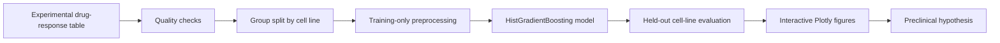

<p align="center">
  
</p>

<h1 align="center">Kexia AI Drug Response</h1>

<p align="center">
  <strong>Machine learning for transparent preclinical drug-response research</strong>
</p>

<p align="center">
  <a href="https://www.python.org/"></a>
  <a href="https://scikit-learn.org/"></a>
  <a href="https://plotly.com/python/"></a>
  
  <a href="./LICENSE"></a>
</p>

<p align="center">
  <em>Research software. Not a diagnostic, treatment recommender, or clinical decision system.</em>
</p>

---

## Why Kexia?

Kexia is a compact, reproducible machine-learning project for studying **preclinical drug sensitivity** in breast-cancer cell lines. It estimates experimental response values, evaluates generalization to **unseen cell lines**, and produces interactive figures for error analysis.

The goal is not to claim a cure. The goal is to turn experimental drug-screen data into **testable laboratory hypotheses** with explicit validation boundaries.



## Scientific target

The model predicts `LN_IC50`, the natural logarithm of an experimentally fitted IC50 in micromolar:

$$
\mathrm{LN\_IC50} = \ln\left(\mathrm{IC50}_{\mu M}\right)
$$

$$
\mathrm{IC50}_{\mu M} = \exp\left(\mathrm{LN\_IC50}\right)
$$

Lower values can indicate that a lower concentration was needed to reach the assay-defined IC50 in that cell-line experiment. They do **not** establish clinical efficacy, patient benefit, or a cellular death rate.

## What is inside

| Component | Purpose |
|---|---|
| `src/kexia_portfolio/modeling.py` | Training pipeline and serializable ML artifact |
| `src/kexia_portfolio/splits.py` | Cell-line group holdout without cell overlap |
| `src/kexia_portfolio/metrics.py` | MAE, RMSE, R², Pearson, and Spearman evaluation |
| `src/kexia_portfolio/plots.py` | Interactive Plotly prediction and error figures |
| `scripts/train_model.py` | Command-line training workflow |
| `scripts/make_figures.py` | Interactive HTML figure generation |
| `tests/` | Automated regression test |

## Validation philosophy

Randomly splitting rows can place observations from the same cell line on both sides of a test. That makes performance look better than it is for a new biological model.

Kexia instead holds out complete `SANGER_MODEL_ID` groups:

$$
\mathcal{C}_{train} \cap \mathcal{C}_{test} = \varnothing
$$

This asks a more useful question:

> Can the model estimate drug response for a cell line it did not see during training?

## Reproducible baseline

The following result was generated locally using the real processed Kexia breast-cancer dataset, with 42 cell lines for training and 10 unseen cell lines for evaluation.

| Metric | Value |
|---|---:|
| MAE | 1.0600 |
| RMSE | 1.4250 |
| R² | 0.6915 |
| Pearson correlation | 0.8449 |
| Spearman correlation | 0.7750 |
| Cell-line overlap | 0 |

These values are a reproducible project baseline, not a clinical benchmark. Results will change with dataset version, feature availability, split seed, and model configuration.

## Quick start

```bash
python -m venv .venv
.venv\Scripts\Activate.ps1
python -m pip install -r requirements.txt
python scripts/train_model.py --input path/to/drug_response_table.csv.gz
python scripts/make_figures.py
python -m pytest
```

After training, local outputs are created in `artifacts/`:

```text
artifacts/
├── drug_response_model.joblib
├── evaluation.json
├── predictions.csv
└── figures/
    ├── observed_vs_predicted.html
    └── error_by_cell.html
```

Open the HTML files in a browser to explore predictions and error patterns interactively.

## Expected input schema

The minimum required columns are:

```text
SANGER_MODEL_ID, DRUG_ID, LN_IC50
```

The pipeline automatically uses available assay, molecular, and pharmacological columns:

```text
MIN_CONC, MAX_CONC, ploidy_snp6, mutational_burden,
doubling_time_hours, growth_rate_per_hour,
MUT_*, CN_*, PUTATIVE_TARGET, PATHWAY_NAME, SCREENING_SITE
```

All preprocessing steps are fit using the training partition only.

## Repository layout

```text
.
├── assets/                 # Kexia identity
├── data/                   # Local only, excluded from Git
├── artifacts/              # Local outputs, excluded from Git
├── scripts/                # Reproducible command-line workflows
├── src/kexia_portfolio/    # Core Python package
└── tests/                  # Automated checks
```

## Research integrity

- Cell-line results are not patient outcomes.
- `LN_IC50` is not a cure probability.
- Predicted sensitivity is not evidence of treatment benefit.
- Model uncertainty and out-of-distribution cases require experimental follow-up.
- Data are not included; obtain them from official sources and comply with their licenses.

## Next steps

- Add externally validated molecular features.
- Evaluate compounds by verified chemical scaffold.
- Compare against simple drug-mean baselines.
- Add calibrated uncertainty under cell-line and compound shifts.
- Benchmark on independent public drug screens.

## Publish to GitHub

```bash
git add .
git commit -m "Initial Kexia AI drug-response portfolio"
git remote add origin https://github.com/YOUR_USERNAME/kexia-ai-drug-response.git
git push -u origin main
```

Before pushing, run:

```bash
git status --ignored
```

The provided `.gitignore` keeps private or licensed data, local model binaries, predictions, and generated figures out of the public repository.

---

<p align="center">
  Built for reproducible computational oncology research.
</p>
